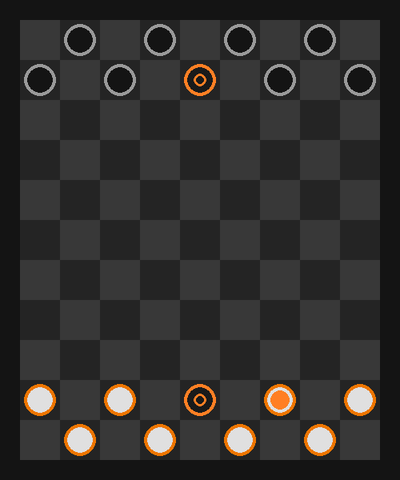

# Basketball Checker

A board game that mixes checkers and basketball. You play against a bot that scores every legal move with a linear model. A Monte Carlo test of 5000 games measures how strong the bot is and where the game is not fair.

Python and Pygame. No game engine, no AI library.

<p align="center">
  
</p>

## Results

5000 games per test, fixed seeds, `python simulate.py 5000`. The intervals are 95 % Wilson intervals.

| Test | Result |
| --- | --- |
| Bot against random moves | Bot wins **97.6 %** (97.2 % to 98.0 %) |
| Bot against bot: White wins | **65.2 %** (63.9 % to 66.5 %) |
| Bot against bot: the team with the ball first wins | **43.4 %** (42.1 % to 44.8 %) |
| Game length, bot against bot | median 36 half moves (P10 22, P90 102) |
| Games without a winner after 400 half moves | 18 of 5000 |

Both teams use the same bot with the same weights. In a fair game, each team wins about 50 %. White wins 65 %, so the rules or the code favour White. The next section explains the cause.

## Finding: a hidden bias of 15 points

I tested one cause at a time and kept everything else the same (3000 to 4000 games per test).

| Change | White wins |
| --- | --- |
| None | 65 % |
| Reverse the order of the piece list | 35 % (the bias goes to Black) |
| Give the ball to a random opponent after a time limit turnover | 50 % |

The cause is in `sanctions_time_stay_basket`. When the time limit removes the ball carrier, the ball goes to the **first** opponent piece in `piece_list`, not to a random one. The board creates the pieces row by row from the top. So the first Black piece in the list starts in the back row of Black, and the first White piece starts in the front row of White. After a turnover, White gets the ball on a piece that is nearer to the goal.

The time limit is not a rare rule. In 3000 bot games, about 4 pieces per game left the board because of it, and 8 of 10 games had at least one ball turnover. A small detail in the code changes the result of the whole game.

The second result is open: the team that starts with the ball wins only 43 %. This stays the same when the handover is random, so it comes from the rules, not from the bug. A possible cause: at the start, the defence has the easier task. Not tested yet.

A smaller finding: two of the four fixed scoring rules check the wrong square, `(10, 5)` in place of `(8, 5)`. They never trigger. In a test of 3000 games, the bot still took all 2989 possible winning moves, because the score finds them.

## How the bot decides

The bot does not search a game tree. It looks one move ahead.

1. **Fixed rules first.** If the ball carrier can jump over the opponent basket, the bot does it. If an opponent can score on the next move, the bot marks the square that blocks it.
2. **Score every legal move.** For each piece and each target square, the bot adds the features below.
3. **Play the best move.** The bot plays the move with the highest score. A random value of at most 0.01 breaks ties.

| Feature | Weight |
| --- | --- |
| Distance to the target (rows count double). With the ball, the target is the nearest scoring square. Without the ball, it is the opponent ball carrier | minus distance |
| Jump over the opponent ball carrier and take the ball | +700 |
| Move to the square that blocks an opponent score | +540 |
| Ball carrier reaches a scoring square | +400 |
| The ball can be taken after this move | −460 |
| Another piece can be taken after this move | −35 |
| Move a piece out of the time limit zone (counter 1, 2, 3) | +3, +8, +16 |
| Move a piece that is not the ball carrier while the team attacks | −80 |
| Keep the landing square behind the basket free | +90, −120 |
| Leave the guard square at the own basket while defending | −45 |
| Move into the attack zone near the opponent basket | +8 |
| Jump over a normal piece | +8 |

In quant terms, this is a linear scoring model with hand set weights and a greedy policy. The weights do not come from data yet. That is the next step.

## Next steps

1. **Fix the handover** and run the test again. Expected result: about 50 % for each team.
2. **Fit the weights by self play.** Change one weight, play 2000 games against the old bot, keep the change only if the win rate is above 50 % with 95 % confidence.
3. **Look two moves ahead** with minimax and measure how much stronger the bot gets per extra second of thinking.
4. **Merge the two bot functions.** `bot_think` and `bot_think_simulation` are the same code for two colours. One function with the colour as a parameter removes about 190 lines.

## Rules

The board has 11 rows and 9 columns. Each team has 8 players and 1 basket.

1. At the start, a random player gets the ball. Its team starts. Against the bot, a White player always gets the ball.
2. A player moves one square diagonally forward. At the end of the board, it turns around.
3. A player can jump diagonally over an opponent. The square behind must be free. The opponent leaves the game. If it had the ball, the jumping player gets it.
4. The ball carrier can pass to a team mate in the same row or column. No piece can be between them.
5. **Score:** the ball carrier jumps over the opponent basket. This wins the game.
6. **Time limit:** the 4 squares diagonal to a basket count the turns of a player that stays there. A dot shows the count: yellow 1, light red 2, red 3. At 4, the player leaves the game. If it had the ball, the other team gets the ball.

## Run it

Python 3.13 or newer. Install `pygame-ce`, not `pygame`. The two packages use the same module name.

```
pip install -r requirements.txt
python main.py
```

Type a mode in the terminal and press Enter:

| Mode | Input |
| --- | --- |
| You (White) against the bot | `bot` or `b` |
| Two players on one computer | `1v1`, `1` or `v` |
| Bot against bot | `simulation` or `s` |

Click a piece of the active team (orange ring). The possible squares get lighter. Click a light square to move.

Run the analysis without a window:

```
python simulate.py          # 2000 games per test, about 20 s
python simulate.py 10000
```

## Files

| File | Content |
| --- | --- |
| `main.py` | Window, input, drawing |
| `board.py` | Rules and bot |
| `Piece.py` | Piece, colours, directions |
| `simulate.py` | Monte Carlo analysis without a window |
| `old_board.py` | Earlier version of the rules, only for comparison |
